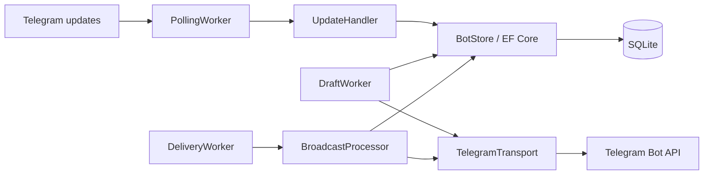

# TgBroadcast

Telegram-бот для рассылок на **C# и .NET 10**. Подписчики, черновики и очередь доставки хранятся в SQLite через EF Core.


[](https://github.com/mtropitsyn/TgBot/actions/workflows/ci.yml)

## Что умеет бот

- Подписка через `/start`, отписка через `/stop` и повторная подписка.
- Создание рассылки администратором в личном чате: текст, медиа, альбомы, опросы.
- Подтверждение или отмена **конкретного** черновика: кнопки отправляются ответом на исходное сообщение.
- Снимок списка получателей в момент подтверждения; повторное нажатие не создаёт вторую рассылку.
- Фоновая очередь с сохранением прогресса, повторными попытками и обработкой Telegram `retry_after`.
- Деактивация подписчика при блокировке бота; пропуск получателей, отписавшихся до отправки.
- Итоговый отчёт об отправленных, неудачных и пропущенных доставках; `/stats` для администратора.

## Локальный запуск

Нужен [.NET 10 SDK](https://dotnet.microsoft.com/download/dotnet/10.0).
Все команды ниже выполняются из корня репозитория.

```bash
git clone https://github.com/mtropitsyn/TgBot.git
cd TgBot
dotnet restore TgBroadcast.sln
```

Задайте настройки через .NET user secrets:

```bash
dotnet user-secrets set "Bot:Token" "YOUR_NEW_BOT_TOKEN" --project src/TgBroadcast
dotnet user-secrets set "Bot:AdminUserId" "YOUR_NUMERIC_TELEGRAM_USER_ID" --project src/TgBroadcast
dotnet run --project src/TgBroadcast
```

Также поддерживаются переменные окружения `Bot__Token` и `Bot__AdminUserId`; они имеют приоритет над user secrets.
Используйте свой числовой ID пользователя Telegram, не username и не ID бота.
База `data/tgbroadcast.db` создаётся автоматически, миграции применяются при запуске.
Каталог базы разрешается относительно текущей рабочей папки.

Токен исходной Python-версии был записан в коде и остался в истории Git. Перед запуском C#-версии перевыпустите его через [BotFather](https://t.me/BotFather).
Репозиторий остаётся приватным; для публичной версии потребуется отдельно удалить секрет из истории.

## Сценарий рассылки

1. Пользователи открывают бота и выполняют `/start`.
2. Администратор отправляет боту сообщение либо альбом в личном чате.
3. Бот отвечает на это сообщение кнопками «Подтвердить» / «Отменить».
4. После подтверждения получатели фиксируются в базе, а фоновый worker выполняет доставку.
5. Администратор получает итог с числом успешных, неудачных и пропущенных доставок.

Альбом собирается после паузы между его частями. До подтверждения новые части добавляются в тот же черновик.
После подтверждения состав рассылки неизменяем; о поздней части бот сообщает администратору.
Опросы пересылаются с указанием источника, остальные сообщения копируются.

## Docker Compose

```bash
cp .env.example .env
```

В Windows PowerShell вместо `cp` можно использовать `Copy-Item .env.example .env`.
Заполните `.env` новым токеном и числовым ID администратора, затем выполните:

```bash
docker compose up --build -d
docker compose logs -f bot
```

SQLite хранится в постоянном томе `bot-data`. Контейнер работает от непривилегированного пользователя.
Файл `.env` читает Docker Compose; при `dotnet run` используйте user secrets или переменные окружения.
Для одного токена запускайте один экземпляр: перед переходом остановите Python-бота. Long polling требует отсутствия активного webhook.

## Импорт подписчиков из Python-версии

Старый формат — JSON-массив положительных числовых ID личных чатов. Импорт удаляет дубликаты и повторно активирует существующие записи.

```bash
dotnet run --project src/TgBroadcast -- --import-subscribers /path/to/subscribers.json
```

Импорт и команда ниже не требуют токена и не обращаются к Telegram:

```bash
dotnet run --project src/TgBroadcast -- --init-db
```

Данные подписчиков и рабочая база не включаются в Git. Исходная Python-версия сохранена в истории репозитория до перехода на .NET.

## Архитектура



```text
src/TgBroadcast/
├── Configuration/  # Настройки и проверка обязательных значений
├── Data/           # DbContext и сущности
├── Migrations/     # Миграции EF Core и снимок модели
├── Services/       # Подписки, черновики, очередь и повторные попытки
├── Telegram/       # Обработка команд, callback и адаптер Telegram.Bot
└── Workers/        # Получение обновлений, подтверждения и доставка
tests/TgBroadcast.Tests/
```

Короткие изменения SQLite сериализуются внутри одного экземпляра приложения. Сетевые вызовы выполняются вне блокировки базы.
Прогресс получателя и offset обработанных Telegram updates сохраняются между перезапусками.

## Тесты и CI

```bash
dotnet test TgBroadcast.sln --configuration Release
dotnet tool restore
dotnet ef migrations has-pending-model-changes --project src/TgBroadcast
```

Тесты используют настоящую SQLite во временных файлах, подменённый транспорт и HTTP-обработчик SDK: реальные сообщения не отправляются.
Проверяются права администратора, независимые черновики, двойное подтверждение, альбомы, отписка, восстановление очереди, ошибки Telegram и итоговые отчёты.
CI также собирает контейнер и проверяет применение миграций без доступа к сети.

## Настройки

| Ключ / переменная окружения | По умолчанию | Назначение |
| --- | --- | --- |
| `Bot__Token` | — | Токен Telegram-бота |
| `Bot__AdminUserId` | — | ID администратора |
| `Bot__DatabasePath` | `data/tgbroadcast.db` | Файл SQLite |
| `Bot__SendIntervalMilliseconds` | `100` | Пауза между доставками, минимум 50 мс |
| `Bot__MaxDeliveryAttempts` | `5` | Число попыток, от 1 до 20 |
| `Bot__MediaGroupDelayMilliseconds` | `1500` | Пауза сбора альбома, 500–10 000 мс |
| `Bot__DraftLifetimeHours` | `24` | Срок подтверждения черновика, 1–168 часов |

## Границы надёжности

- При аварии после успешного ответа Telegram, но до записи результата в SQLite, последняя доставка может повториться. Telegram не предоставляет ключ идемпотентности для копирования сообщений; здесь используется семантика **at least once**.
- Паузы и `retry_after` учитывают ограничения Telegram, но исчерпавшие лимит попыток доставки отмечаются как неудачные.
- Если Telegram скопировал только часть альбома, доставка отмечается как неудачная и целиком автоматически не повторяется.
- Очередь и SQLite рассчитаны на один запущенный экземпляр бота. Публичного веб-интерфейса и горизонтального масштабирования в этой версии нет.
